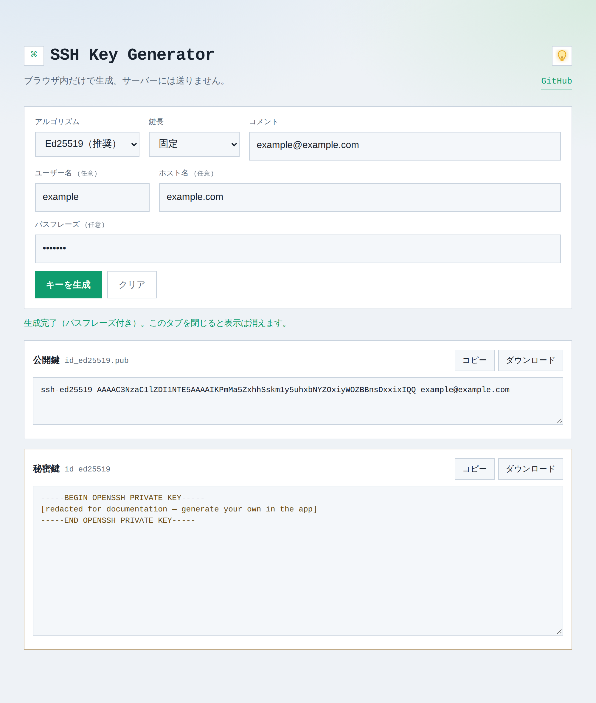

# SSH Key Generator

ブラウザ内だけで SSH 鍵ペアを生成する静的 Web アプリです。  
生成した鍵はサーバーへ送信・保存しません。タブを閉じると画面上の鍵は消えます。

公開サイト: [https://ssh-key-generator.debugprint.com/](https://ssh-key-generator.debugprint.com/)

## スクリーンショット



## 機能

- アルゴリズム: Ed25519 / RSA / ECDSA
- 鍵長選択（RSA・ECDSA）
- コメント、ユーザー名・ホスト名・パスフレーズ（任意）
- 公開鍵・秘密鍵の表示、コピー、ダウンロード
- ダーク / ライト切替（Cookie に保存）
- 公開鍵の登録手順・`~/.ssh/config` の短い名前設定の説明

## ローカル起動

```bash
docker compose up -d --build
# http://127.0.0.1:8002/
```

停止:

```bash
docker compose down
```

## 使い方

1. アルゴリズムなどを選び「キーを生成」
2. 公開鍵（`.pub`）と秘密鍵をダウンロード
3. 秘密鍵は手元の `~/.ssh/` のみに置く（`chmod 600`）
4. 公開鍵は接続先の `authorized_keys` や Git ホストの SSH keys に登録
5. 任意で `~/.ssh/config` に短い `Host` 名を書くと短い名前だけで接続できる

詳細なコマンド例はアプリ画面下部のヘルプを参照してください。

## 構成

```
├── Dockerfile
├── docker-compose.yml
├── nginx.conf
└── public/
    ├── index.html
    ├── styles.css
    └── app.js
```

## 注意

- 秘密鍵をリポジトリやサーバーへ置かないでください
